# TP2 : Continuous Delivery, Quality & Security Gates et Ingénierie SRE

Membres du groupe : Salma Sghaier, Issra Brini, Youssef Abid  
Classe : GL5 groupe 1

## Objectif

Ce TP met en place une chaîne de livraison continue sécurisée pour un microservice de paiement, de la PR jusqu'à la production, puis mesure sa fiabilité sous charge avec les outils SRE. Chaque étape est une barrière automatique : tests et couverture, Quality Gate SonarQube, scan Trivy, politiques OPA Gatekeeper à l'admission Kubernetes, déploiement GitOps avec ArgoCD, puis observabilité (métriques, logs, traces) et alerting sur la consommation de l'Error Budget.

Dépôt Git : https://github.com/salmasgh/tp2-devops

## Environnement et architecture

Le cluster est un Minikube local (Kubernetes v1.37, 8 CPU / 10 Go alloués au conteneur). La CI tourne sur GitHub Actions et publie l'image dans GitHub Container Registry (GHCR). Les composants installés dans le cluster sont :

- OPA Gatekeeper 3.23 (namespace gatekeeper-system) pour le Policy Enforcement.
- ArgoCD 2.14 (namespace argocd) qui synchronise l'overlay Kustomize k8s/overlays/dev vers le namespace tp2.
- kube-prometheus-stack (Prometheus, Alertmanager, Grafana), Loki, Tempo et un OpenTelemetry Collector en DaemonSet (namespace monitoring).
Organisation du dépôt : app/ (code FastAPI), tests/ (pytest), Dockerfile, .github/workflows/ci.yml, ci/sonar-setup.sh, policies/ (ConstraintTemplates Rego et manifestes de test), k8s/ (Kustomize base + overlay dev), argocd/ (Application), observability/ (valeurs Helm, règles SLO, dashboard Grafana) et k6/ (test de charge).

## Étape 1 : Microservice et tests unitaires

### Application

Le microservice payment-api est écrit en Python avec FastAPI. Il expose un catalogue (/products), la création et la consultation de paiements (/payments, validation Pydantic : montant entre 0 et 10 000, devise EUR, USD ou TND), un endpoint lent /checkout (latence aléatoire entre 50 et 250 ms, réglable par variables d'environnement), un endpoint /flaky qui renvoie une erreur 500 avec une probabilité FLAKY_ERROR_RATE (10 % par défaut), et /metrics au format Prometheus. Un middleware alimente les métriques RED : http_requests_total{method, route, status} et l'histogramme http_request_duration_seconds, dont un bucket est placé exactement à 200 ms pour mesurer le SLO de latence.

### Tests et couverture

28 tests pytest couvrent les cas nominaux et les cas limites : produit inexistant ou identifiant invalide, montant nul, négatif ou supérieur au maximum, devise inconnue, client manquant, borne de 10 000 acceptée, taux d'erreur forcé à 0, à 1, invalide ou hors bornes, formatage JSON des logs avec et sans trace active. pytest-cov produit les rapports Cobertura (coverage.xml, lu par SonarQube) et LCOV (coverage.lcov). L'option --cov-fail-under=85 fait échouer la CI si la couverture passe sous 85 %. La couverture obtenue est de 100 % (lignes et branches).

Exécution des tests et rapport de couverture :

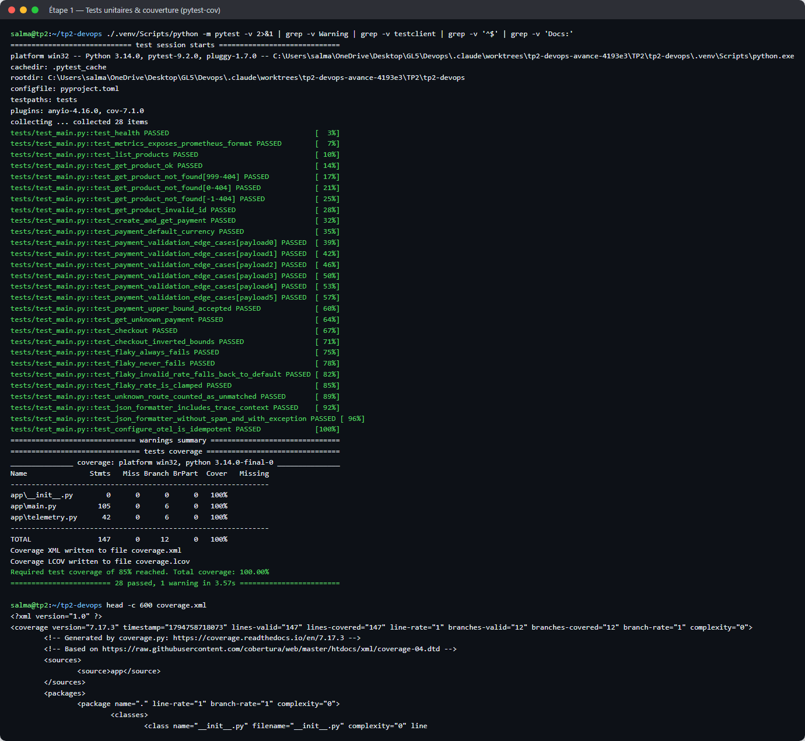

## Étape 2 : Quality Gate SonarQube et OPA Gatekeeper

### Quality Gate SonarQube

Pour éviter de dépendre d'un compte externe, la CI démarre une instance SonarQube 10.7 Community éphémère dans le job. Le script ci/sonar-setup.sh attend que le serveur soit UP, change le mot de passe admin par défaut (valeur lue depuis le secret GitHub SONAR_ADMIN_PASSWORD), crée la Quality Gate TP2-Strict-Gate, la définit par défaut et génère un token d'analyse masqué dans les logs. Conditions bloquantes de la gate :

- Couverture < 85 % (code global et nouveau code).
- Security Hotspots revus < 100 % : un seul hotspot non révisé suffit à faire échouer la gate.
- Duplication > 3 % (code global et nouveau code).
- Bugs > 0 et vulnérabilités > 0.
Le scanner est lancé avec sonar.qualitygate.wait=true : si la gate est en ERROR, le scanner sort en code 3 et le job échoue, ce qui bloque les étapes Build, Trivy et Push. Un tableau récapitulatif des conditions est écrit dans le résumé du run GitHub.

Quality Gate TP2-Strict-Gate configurée par le script :

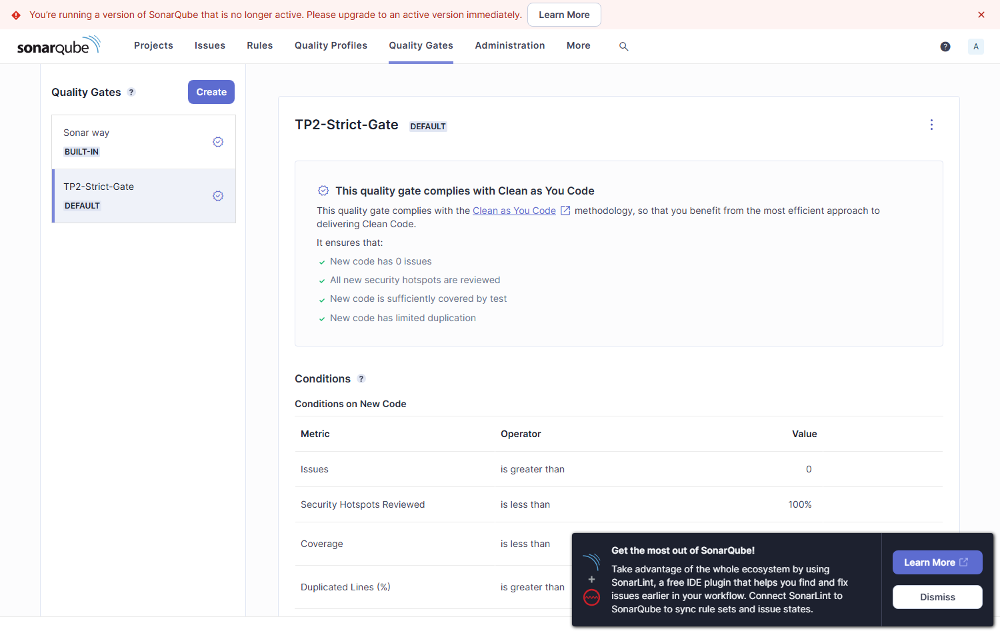

Analyse de la branche main : Quality Gate Passed (couverture 100 %, 0 duplication, 0 hotspot) :

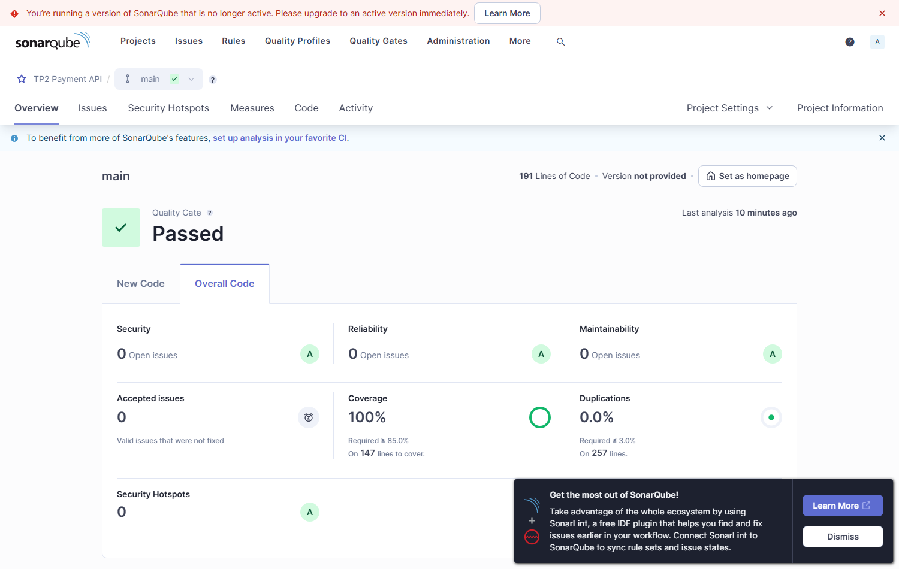

### PR non conforme bloquée par la Quality Gate

La PR #1 (branche feature/refunds-non-conforme) ajoute quatre endpoints de remboursement copiés-collés qui utilisent random et MD5 pour générer leurs identifiants. Les tests passent et la couverture reste à 97 %, donc l'étape 1 est verte, mais SonarQube mesure 20,7 % de duplication et 0 % de Security Hotspots revus. La Quality Gate est en échec et la pipeline s'arrête : aucune image n'est construite ni publiée.

Run CI de la PR #1 : l'étape SonarQube échoue, les étapes suivantes sont ignorées :

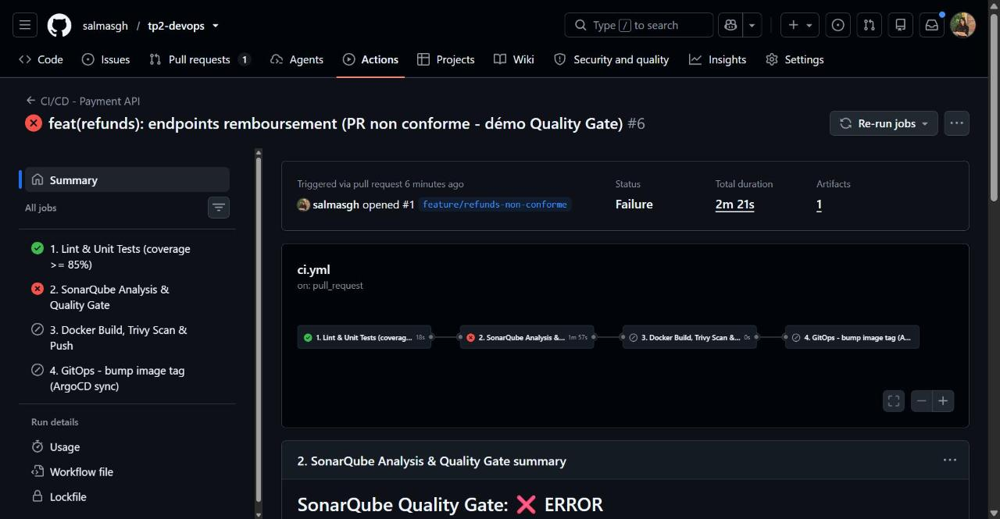

Résumé du run : conditions de la gate en ERROR (duplication 20,7 % > 3 %, hotspots revus 0 % < 100 %) :

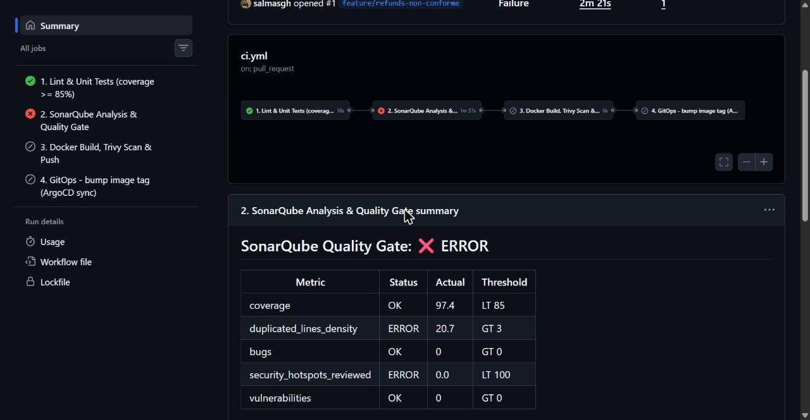

Log du scanner : QUALITY GATE STATUS: FAILED et code de sortie 3 :

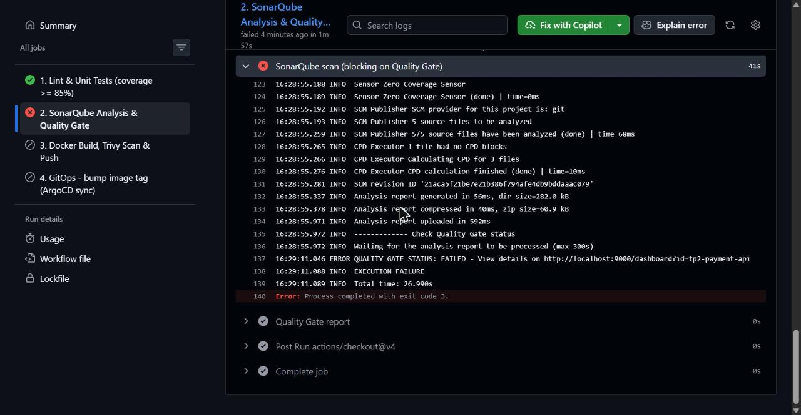

Statut de la PR : le check SonarQube est en échec :

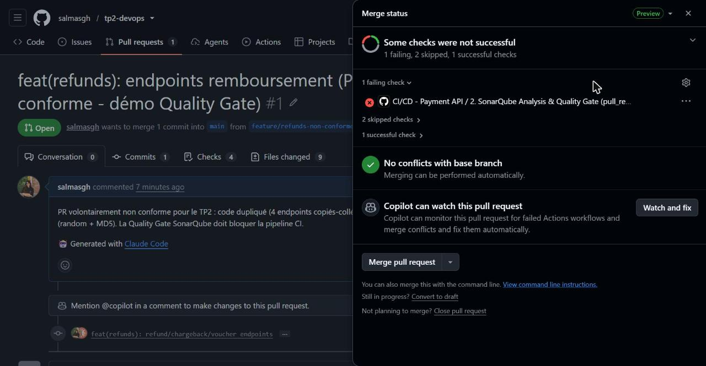

Même analyse dans l'interface SonarQube : 2 conditions en échec :

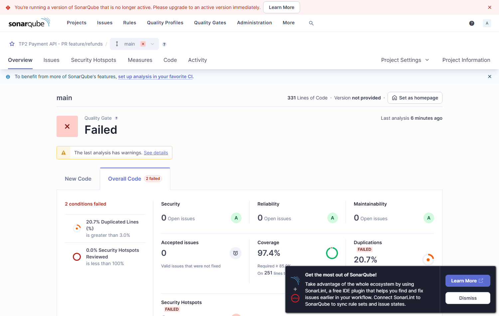

Security Hotspots détectés (générateur pseudo-aléatoire et hachage MD5) :

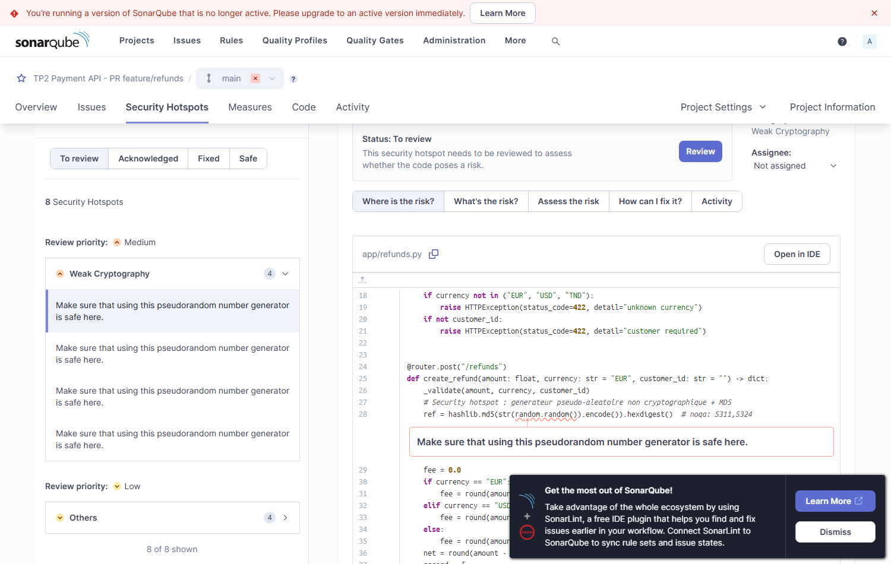

Remarque : GitHub autorise encore le bouton Merge car la branche main n'a pas de règle de protection. En production, on activerait la règle « Require status checks to pass » sur ce check pour rendre le blocage obligatoire.

### Policy Enforcement avec OPA Gatekeeper

Gatekeeper est installé avec Helm. Deux ConstraintTemplates en Rego sont appliquées aux Pods et aux workloads (Deployment, StatefulSet, DaemonSet, ReplicaSet, Job, CronJob) des namespaces portant le label policy.tp2/enforced=true, ce qui évite de casser les composants système :

- K8sDisallowLatestTag : refuse une image taguée :latest et aussi une image sans tag, qui revient implicitement à latest.
- K8sRequiredResources : exige resources.requests et resources.limits pour cpu et memory sur chaque conteneur (y compris les initContainers).
Gatekeeper, ConstraintTemplates et Constraints en mode deny :

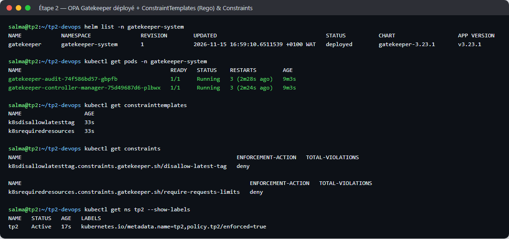

Les manifestes de policies/tests sont rejetés directement par l'API Server via le webhook validation.gatekeeper.sh, avec un message qui indique le conteneur et la règle violée. Le pod conforme (tag explicite et ressources définies) est accepté :

Rejet des manifestes non conformes et acceptation du manifeste conforme :

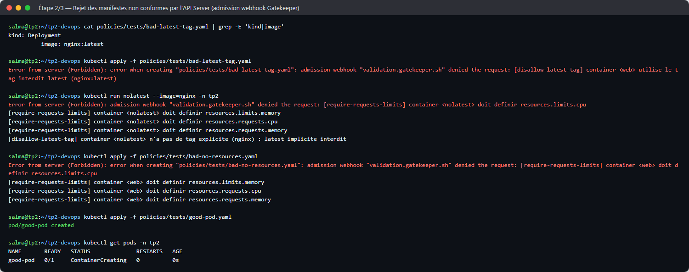

## Étape 3 : Pipeline CI/CD et déploiement GitOps

### Pipeline GitHub Actions

Le workflow .github/workflows/ci.yml enchaîne quatre jobs, chacun dépendant du précédent :

- Lint & Test : ruff (lint et format), pytest avec seuil de couverture à 85 %, artefact coverage.xml/lcov.
- SonarQube Analysis & Quality Gate : analyse statique et gate bloquante.
- Docker Build, Trivy Scan & Push : build multi-stage (utilisateur non-root), scan Trivy, puis push vers ghcr.io/salmasgh/tp2-devops avec le SHA du commit et un tag build-N. Le push n'a lieu que sur main.
- GitOps : met à jour newTag dans k8s/overlays/dev/kustomization.yaml et pousse un commit [skip ci] signé github-actions[bot].
Gestion des secrets : aucun secret n'est en clair dans le dépôt. Le push GHCR utilise le GITHUB_TOKEN éphémère avec la permission packages: write limitée au job de build, le job GitOps a seul contents: write, le mot de passe SonarQube vient d'un secret GitHub et le token d'analyse est masqué (::add-mask::). Côté cluster, l'URL du webhook Slack est stockée dans un Secret Kubernetes monté dans Alertmanager.

Run sur main : les quatre étapes sont vertes et la Quality Gate est OK :

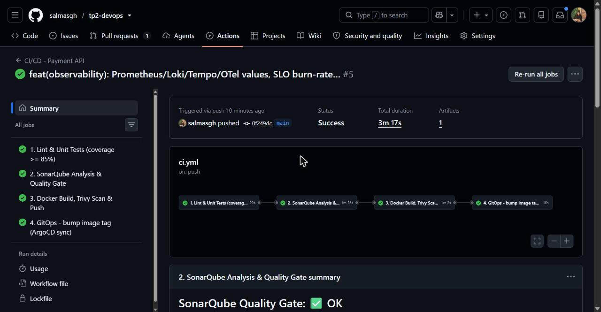

### Scan de vulnérabilités Trivy

Trivy (version figée 0.58.1) affiche d'abord les vulnérabilités HIGH et CRITICAL pour information, puis fait échouer le job s'il trouve au moins une CRITICAL corrigeable (--severity CRITICAL --ignore-unfixed --exit-code 1). L'image ne contient aucune CRITICAL ; les HIGH restantes viennent de paquets Debian sans correctif publié.

Scan Trivy de l'image :

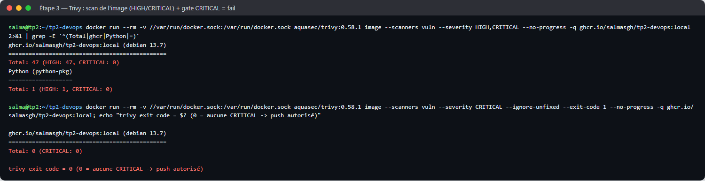

Image publiée dans GitHub Container Registry, taguée par SHA et numéro de build :

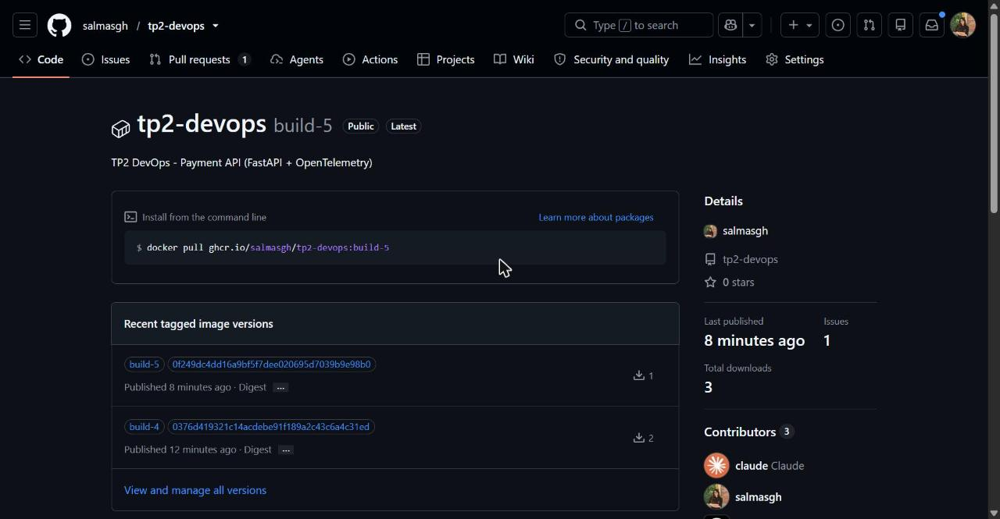

### Déploiement continu avec ArgoCD

L'Application ArgoCD payment-api suit la branche main, chemin k8s/overlays/dev (Kustomize : namespace tp2 labellisé pour Gatekeeper, 3 réplicas, image ghcr.io/salmasgh/tp2-devops au tag écrit par la CI), avec auto-sync, prune et self-heal. À chaque merge, la CI pousse le nouveau tag et ArgoCD déploie la version correspondante sans aucune commande manuelle.

Historique Git : chaque commit applicatif est suivi du commit GitOps du bot :

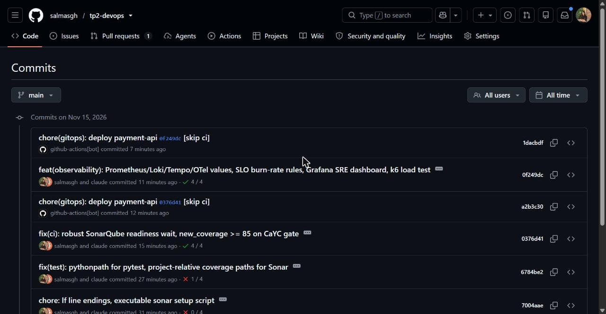

Application payment-api Synced et Healthy (3 pods) :

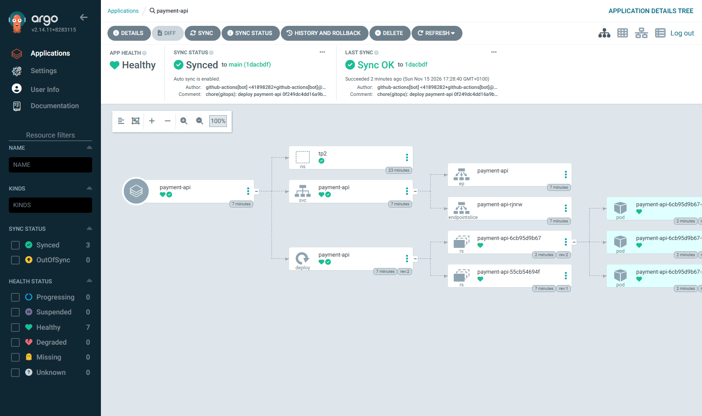

Pour vérifier le rejet au niveau de l'API Server dans le flux GitOps, une seconde Application ArgoCD a été pointée sur les manifestes non conformes. La synchronisation échoue : Gatekeeper refuse le Pod sans ressources et le Deployment en nginx:latest.

Synchronisation ArgoCD refusée par Gatekeeper :

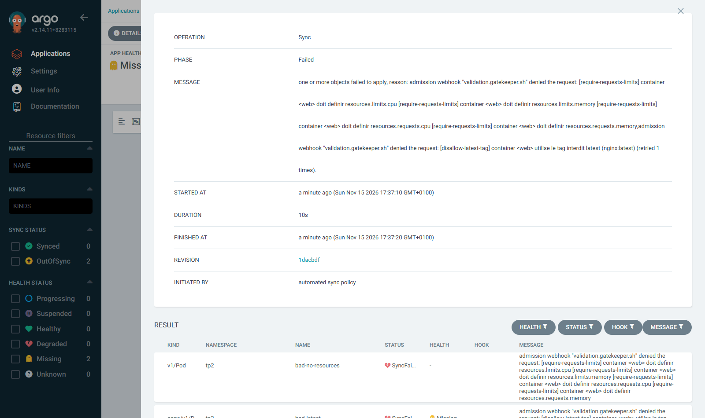

## Étape 4 : Instrumentation et stack d'observabilité

### Instrumentation OpenTelemetry

Le SDK OpenTelemetry est initialisé au démarrage (app/telemetry.py) :

- Traces : FastAPIInstrumentor crée un span par requête et des spans métier (payment.authorize, checkout.process) ; elles partent en OTLP/HTTP vers le Collector puis vers Tempo.
- Métriques : un MeterProvider avec PrometheusMetricReader expose les métriques OTel (http_server_duration_milliseconds...) sur /metrics, à côté des métriques RED de l'application.
- Logs : un formateur JSON écrit sur stdout chaque ligne avec timestamp, level, message, route, status, duration_ms et les trace_id / span_id du span actif.
### Collecte

Prometheus scrape automatiquement tout pod annoté prometheus.io/scrape="true" (job kubernetes-annotated-pods, port et chemin lus dans les annotations). Le Collector OpenTelemetry, déployé en DaemonSet, lit les fichiers de logs des pods du namespace tp2 (receiver file_log), ajoute les attributs Kubernetes, extrait trace_id et level du JSON, puis envoie les logs à Loki en OTLP. Il reçoit aussi les traces de l'application et les transmet à Tempo.

Les trois pods payment-api découverts et scrapés par Prometheus :

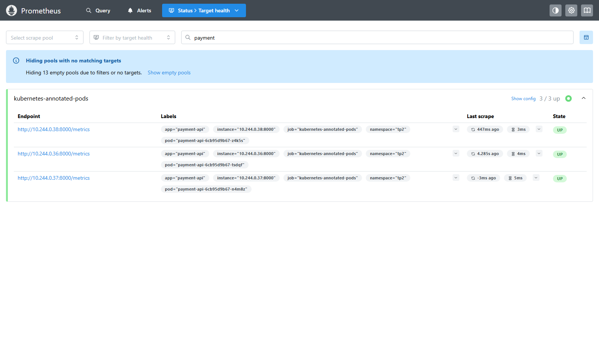

Logs JSON dans Loki (Grafana Explore), avec le trace_id de chaque requête :

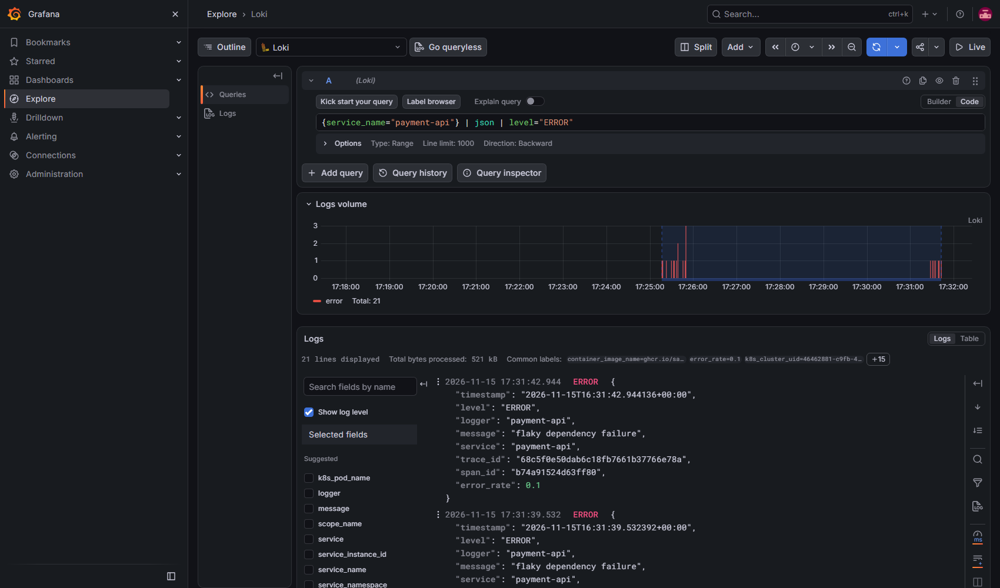

### Corrélation logs et traces

Dans Grafana, la datasource Loki définit un derived field qui transforme le trace_id du log en lien vers Tempo, et la datasource Tempo a l'option tracesToLogs qui ouvre les logs d'une trace (bouton « Logs for this trace »). La capture suivante part d'un log d'erreur /flaky et affiche la trace correspondante (même trace_id) avec ses spans :

Log Loki et trace Tempo côte à côte pour le trace_id 68c5f0e50dab6c18fb7661b37766e78a :

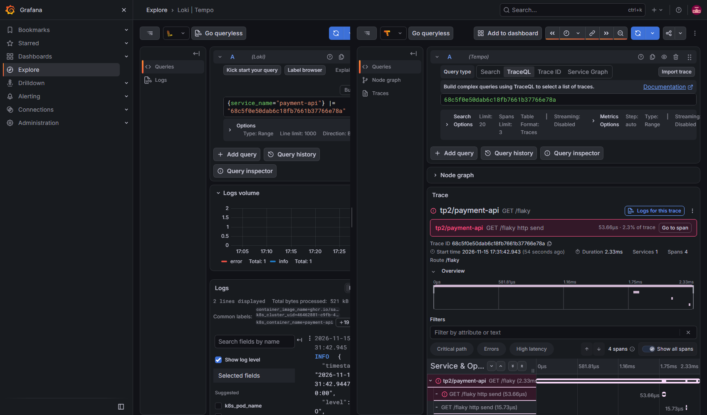

## Étape 5 : Ingénierie SRE, charge et Error Budget

### Contrat de service

- SLI de disponibilité : part des requêtes avec un statut HTTP < 500. SLO : 99,5 % sur une fenêtre glissante de 30 jours.
- SLI de latence : part des requêtes servies en moins de 200 ms (bucket le="0.2"). SLO : 95 % des requêtes, soit p95 ≤ 200 ms.
Error Budget = 1 − 0,995 = 0,5 % de requêtes en erreur sur 30 jours. Le burn rate est le taux d'erreur observé divisé par 0,5 % : un burn rate de 1 consomme exactement le budget en 30 jours (720 h). La consommation du budget sur une fenêtre vaut burn rate × durée / 720 h, d'où les seuils de l'alerting multi-window multi-burn-rate :

- Critical (page) : 2 % du budget en 1 h, soit burn rate = 0,02 × 720 / 1 = 14,4. Condition : burn rate 1 h > 14,4 et burn rate 5 min > 14,4.
- Warning (Slack) : 5 % du budget en 6 h, soit burn rate = 0,05 × 720 / 6 = 6. Condition : burn rate 6 h > 6 et burn rate 30 min > 6.
La fenêtre courte (5 min ou 30 min) évite de garder l'alerte active longtemps après la fin de l'incident, la fenêtre longue évite d'alerter sur un pic bref. Ces règles sont dans observability/slo-rules.yaml (PrometheusRule) sous forme de recording rules (slo:sli_error:ratio_rate5m...6h, slo:burn_rate:*, slo:error_budget_remaining:ratio30d) et d'alertes. Alertmanager route severity=critical vers le receiver pager et severity=warning vers le receiver slack.

Règles d'enregistrement et d'alerte SLO chargées dans Prometheus :

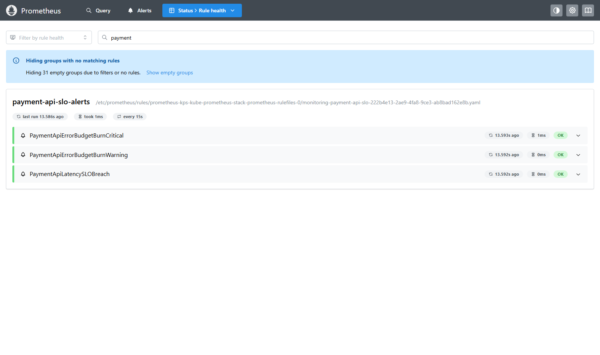

### Test de charge k6

Le script k6/load-test.js tourne dans le cluster sous forme de Job (conforme à Gatekeeper). Chaque utilisateur virtuel enchaîne un mélange réaliste : 30 % /products, 20 % POST /payments, 25 % /checkout et 25 % /flaky, avec une pause de 0,5 à 1 s. Trois scénarios :

- Ramp-up : de 0 à 100 VU en 1 min, palier de 1 min.
- Stress test prolongé : montée à 500 VU puis palier de 4 min.
- Spike test : passage soudain à 1500 VU en 5 s, maintenu 30 s.
Les seuils k6 reprennent le contrat de service côté client : server_errors < 0,5 % et p95 des réponses attendues < 200 ms.

Résultats globaux (10 min de test) : 179 488 requêtes, 291 req/s en moyenne et un pic de 488 req/s pendant le stress test. La latence médiane est de 169 ms, le p95 de 1,39 s et le p99 de 6,4 s. Les trois seuils k6 sont franchis : server_errors = 19,7 %, p95 = 1,47 s sur les réponses attendues et p95 de /checkout = 641 ms.

- Ramp-up (100 VU) : p95 autour de 240 ms, tiré par /checkout ; les seules erreurs viennent de /flaky.
- Stress (500 VU) : le débit plafonne autour de 450 req/s et le p95 monte entre 300 et 500 ms, poussé par /checkout (50 à 250 ms par conception) et la saturation CPU des 3 pods (1 CPU chacun, un seul processus uvicorn).
- Spike (1500 VU) : le p95 côté serveur atteint 4,3 s. Les sondes liveness (timeout 1 s) expirent, Kubernetes redémarre les 3 pods presque en même temps et le Service n'a plus d'endpoint prêt : k6 reçoit des connection refused et connection reset pendant une trentaine de secondes.
Résumé k6 et redémarrage des pods après le spike :

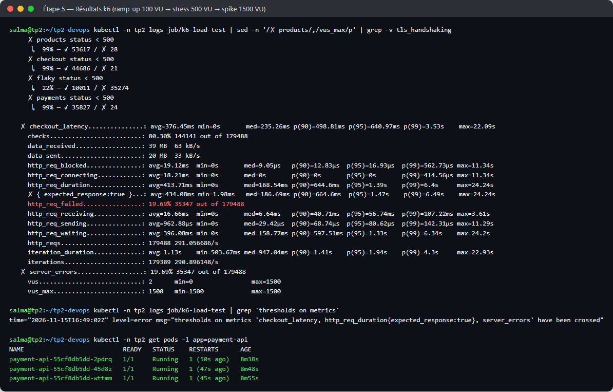

Panneaux RED pendant le test : débit par route, erreurs 5xx, percentiles de latence :

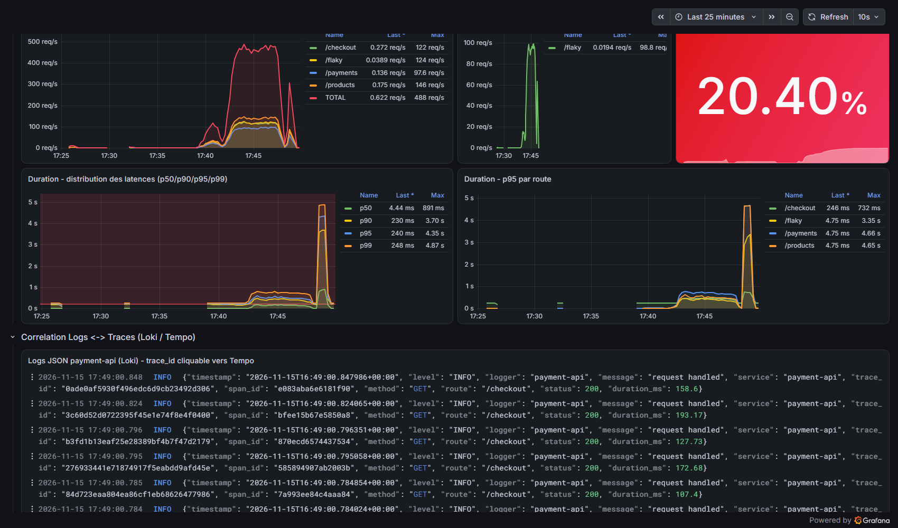

### Incident simulé et analyse

Pendant le test, une release défectueuse est poussée dans Git (FLAKY_ERROR_RATE passe de 0,1 à 0,5 puis 0,8, comme une dépendance externe dégradée). ArgoCD la déploie automatiquement. Déroulé :

- 17:38:54 : démarrage du test k6. Burn rate stable autour de 5 (les 10 % d'erreurs de /flaky sur 25 % du trafic donnent 2,5 % d'erreurs).
- 17:39:30 : la release v1.1 (FLAKY_ERROR_RATE=0,5) est synchronisée par ArgoCD.
- 17:40:21 : burn rate 1 h et 5 min au-dessus de 14,4, l'alerte Critical passe en pending.
- 17:40:35 : la release v1.1.1 (0,8) est synchronisée, le taux d'erreur global atteint 20 %.
- 17:41:21 : PaymentApiErrorBudgetBurnCritical passe en FIRING (après le for: 1m) et part vers le receiver pager ; l'alerte de latence passe aussi en FIRING.
- 17:42:06 : PaymentApiErrorBudgetBurnWarning passe en FIRING (for: 2m) et part vers Slack.
- 17:47 à 17:48 : spike à 1500 VU, redémarrage des pods.
- 17:50:11 : rollback par git revert ; ArgoCD le déploie à 17:50:19.
- 17:54 : le burn rate 5 min retombe à 5,7, l'alerte Critical se résout. La Warning reste active tant que la fenêtre 30 min dépasse 6.
Dashboard SRE pendant l'incident : burn rate ≈ 26 sur toutes les fenêtres, Error Budget épuisé :

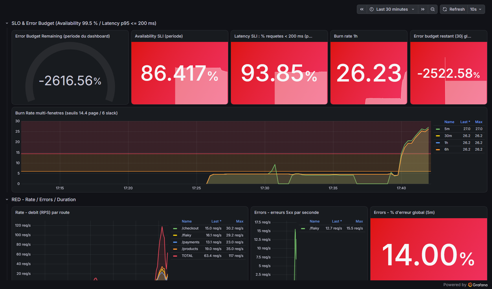

Alertes Prometheus : Critical et latence en FIRING :

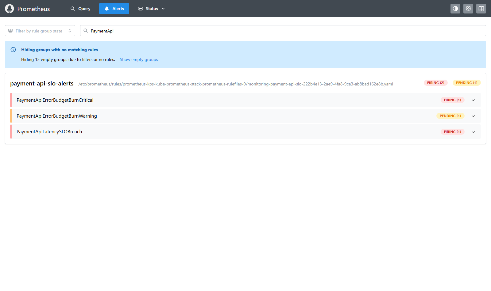

Alertmanager : l'alerte Critical est routée vers pager, l'alerte de latence vers slack :

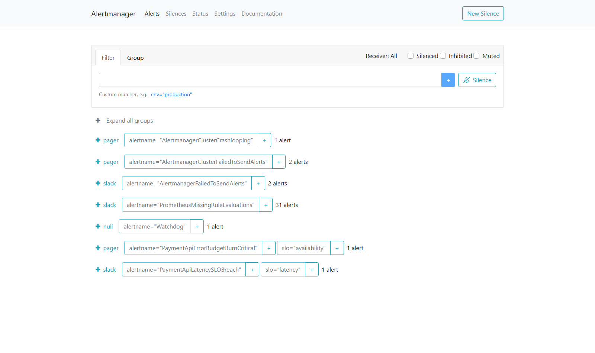

Détail des alertes burn rate : expressions, labels de routage et valeur (burn rate 37) :

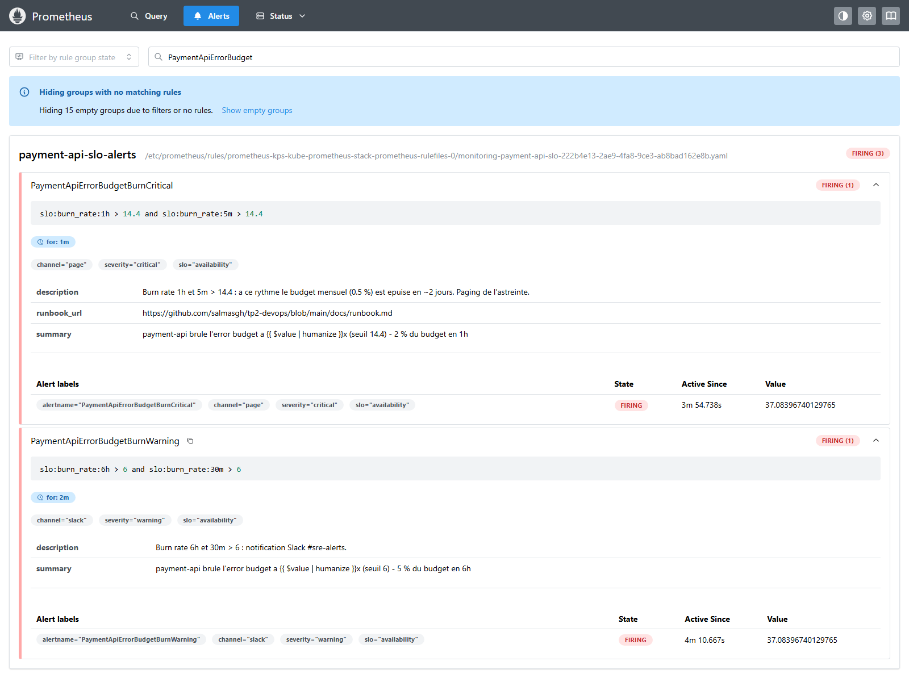

### Calcul de l'Error Budget

Sur les 35 minutes observées, la disponibilité mesurée est de 80,7 %, soit un taux d'erreur de 19,3 %. Le budget de cette période est 0,5 % des requêtes : il a été consommé 19,3 / 0,5 = 38,6 fois, d'où la jauge Error Budget Remaining à 1 − 38,6 = −3 760 %. Prometheus n'ayant que 35 minutes d'historique, la fenêtre de 30 jours donne la même valeur.

Rapporté à un mois de trafic constant, l'incident (burn rate moyen d'environ 38 pendant 13 minutes) consomme 38 × 13 / 60 / 720 ≈ 1,1 % du budget mensuel. Une alerte Critical à 14,4 se déclenche donc avant que 2 % du budget ne soient perdus, ce qui laisse le temps d'agir.

Après le rollback : le burn rate 5 min retombe sous le seuil Critical, les fenêtres longues redescendent plus lentement :

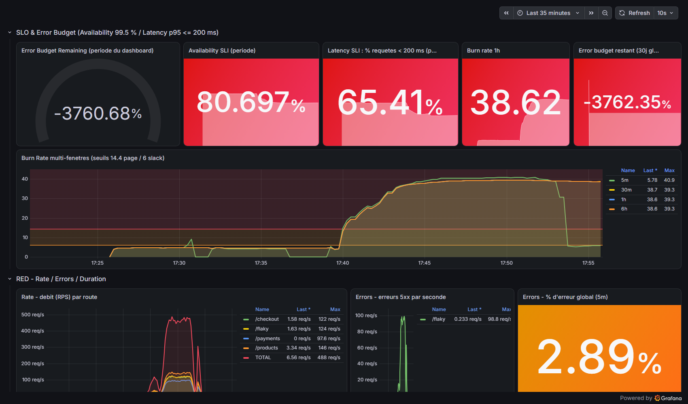

Historique ArgoCD : release fautive, revert, puis déploiement automatique du commit GitOps :

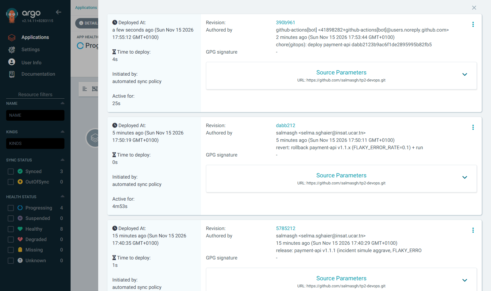

### Enseignements

- Le rollback se fait par git revert : avec l'auto-sync, un rollback depuis l'interface ArgoCD serait écrasé, et Git reste la source de vérité.
- La sonde liveness a aggravé le spike en redémarrant tous les pods en même temps. Correctifs : timeoutSeconds et failureThreshold plus élevés, liveness distincte de la readiness, plusieurs workers uvicorn par pod.
- Le service manque de capacité au-delà de 500 VU : un HorizontalPodAutoscaler sur le CPU et un PodDisruptionBudget sont nécessaires.
- Le SLO de latence est en tension permanente à cause de /checkout, dont la latence va jusqu'à 250 ms par conception. Il faut soit un SLO de latence par route, soit optimiser ce traitement.
- Les alertes AlertmanagerFailedToSendAlerts visibles dans Alertmanager sont attendues : le webhook Slack et le pager du lab sont des URL factices stockées dans un Secret.
La procédure de diagnostic et de remédiation est décrite dans docs/runbook.md, référencé par l'annotation runbook_url de l'alerte Critical.

## Conclusion

La chaîne mise en place applique la qualité et la sécurité à chaque étape, sans intervention manuelle :

- Les tests et la couverture minimale bloquent dès la première étape.
- La Quality Gate SonarQube a bloqué une PR dont les tests passaient, sur la duplication et les hotspots non revus.
- Trivy empêche la publication d'une image avec une vulnérabilité CRITICAL corrigeable.
- Gatekeeper refuse à l'admission tout workload sans tag explicite ou sans requests/limits, y compris quand il arrive par ArgoCD.
- ArgoCD déploie chaque version validée à partir de Git, qui reste la seule source de vérité, et permet le rollback par un simple revert.
- Les métriques RED, les logs JSON et les traces partagent le même trace_id, ce qui permet de passer d'une alerte à la requête fautive.
- L'alerting multi-burn-rate a détecté l'incident en quelques minutes avec le bon niveau de sévérité.
Dépôt Git : https://github.com/salmasgh/tp2-devops
